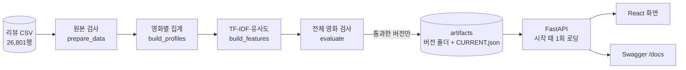

# 포트폴리오용 프로젝트 요약

기준일: 2026-10-11

이 문서는 이력서와 면접에서 이 프로젝트를 설명할 때 **사실로 확인된 것만** 쓰기 위한 정리입니다.
"무엇을 만들었나", "어떻게 확인했나", "아직 안 한 것"을 구분해 두었습니다. 팀 프로젝트이므로 **본인이 맡은 부분은 직접 채워야 합니다**(맨 아래).

## 한 줄 소개

한국 영화 리뷰 26,768건(영화 214편)으로 영화를 추천하는 **FastAPI 백엔드와 React 화면**. 리뷰 글 유사도, 영화 정보, 리뷰 수를 반영한 보정 평점을 합쳐 추천하고, 추천 설정을 바꿔 가며 비교한 보고서를 만들었습니다.

## 구조

- 데이터 준비는 파이프라인(`run_pipeline.py`)이 하고, 서버는 **검사를 통과한 버전만** 시작할 때 한 번 읽습니다. 요청 처리 중에는 CSV를 읽거나 TF-IDF를 계산하지 않습니다.
- 파이프라인이 실패하면 `CURRENT.json`이 이전 정상 버전을 계속 가리킵니다.

## 만든 기능

| 영역 | 내용 |
|---|---|
| 추천 | 같은 장르 → 유사도(0.4×정보 + 0.6×리뷰 + 같은 감독 보너스) 상위 20개 → 0.7×유사도 + 0.3×평점으로 재정렬. 추천 이유와 유사도 구성 표시 |
| 보정 평점 | `B = (v×R + m×C)/(v+m)`: 리뷰 수가 적은 영화의 평균이 튀지 않게 전체 평균 쪽으로 당김 |
| 취향 추천 | 영화 2~5편을 고르면 각각과의 유사도 평균으로 종합 추천 |
| 탐색 | 검색(자동완성·키보드 조작), 전체 영화 정렬·장르·감독 필터·쪽 이동, 영화 비교, 키워드로 영화 찾기 |
| 상세 | 평점 분포, 리뷰 정렬·단어 검색, 대표 키워드, 같은 감독의 다른 영화, 찜·최근 본 영화(브라우저에만 저장) |
| API | 16개 엔드포인트, 응답 구조 문서([API_RESPONSES.md](API_RESPONSES.md)), 오류 계약(404/409/422) |

## 엔지니어링으로 보여줄 수 있는 것

각 항목은 실제로 확인한 방법을 함께 적었습니다.

- **데이터 정합성:** 원본을 수정하지 않고 검사만 합니다. 결측·중복·메타데이터 충돌을 임의로 합치지 않고 중단합니다. 파일에는 SHA-256을 기록해 다른 버전이 섞이면 시작 단계에서 중단합니다. 원본 CSV의 해시가 파이프라인 전후로 같다는 것이 기존 문서(`docs/CURRENT_STATUS.md`)에 기록돼 있습니다(이번 작업에서 다시 확인하지는 않았습니다).
- **입력 검증과 오류 계약:** 범위·형식 오류는 422, 없는 영화는 404, 동명이작은 후보 목록과 함께 409. 자동 테스트로 확인합니다.
- **테스트:** 백엔드 pytest 104개, 프론트 16개(Node 내장 러너). 응답 구조를 실제 데이터로 검사하는 "계약 테스트", 값을 직접 정한 작은 데이터로 계산을 손으로 검증하는 단위 테스트, 전체 214편에서 비교용 계산이 실제 추천 함수와 **한 건도 다르지 않은지** 확인한 검사가 있습니다. 프론트 테스트는 일부러 코드를 망가뜨려 실제로 실패하는 것도 확인했습니다.
- **재현 가능한 환경:** 검증한 패키지 버전을 `requirements.lock.txt`와 `package-lock.json`에 고정. `run.bat` 하나로 서버 실행.
- **응답 속도:** 이 PC에서 측정한 중앙값은 대부분의 조회가 10ms 이하, 추천 약 43ms, 취향 추천(5편 선택) 약 240ms(`TestClient` 기준, 네트워크 제외).

## 추천을 숫자로 검증한 것

[추천 설정 비교 보고서](RECOMMENDATION_EVALUATION.md): 10개 설정(실험 1개 포함)을 영화 212편 전체로 비교했습니다. 이 수치는 추천의 **성질**(안정성, 쏠림, 다양성, 커버리지)이며 사용자 만족도가 아닙니다.

- 평점만으로 추천하는 기준선은 **모든 영화의 76%에 같은 3편**을 추천했고 커버리지가 8.5%였습니다. 현재 방식은 59%.
- 현재 방식에도 한 영화가 목록의 **25%(54/212)** 에 나오는 쏠림이 있고, 쏠림 보정을 실험했을 때 31회, 커버리지 68%로 개선됐습니다(서비스에는 미적용).
- 감독 보너스는 이 데이터에서 사실상 쓰이지 않습니다(같은 장르에 같은 감독의 다른 영화가 있는 영화가 208편 중 14편).
- 가중치(0.4/0.6)를 바꾸면 추천이 크게 달라집니다(겹침 0.25~0.44). 지금 값의 근거는 사람 평가로 아직 확인하지 않았습니다.

## 이력서에 써도 되는 표현

- "FastAPI 기반 영화 추천 API 설계·구현 (검색, 추천, 취향 추천, 비교, 통계 등 16개 엔드포인트)"
- "리뷰 텍스트 TF-IDF 유사도와 영화 정보, 리뷰 수 보정 평점을 결합한 콘텐츠 기반 추천"
- "데이터 검증·버전 관리 파이프라인: 검사를 통과한 버전만 게시, 실패 시 이전 버전 유지(SHA-256)"
- "pytest 104개와 계약 테스트로 API 응답 구조 검증"
- "추천 설정 10종(실험 1개 포함)을 212편 전체로 비교해 쏠림·커버리지 문제를 수치로 확인하고 보정 효과를 실험"
- "React 프론트(팀원 코드를 이어받아 상세·추천·비교·탐색 화면 확장)"

## 아직 쓰면 안 되는 표현

| 쓰지 말 것 | 이유 |
|---|---|
| "추천 정확도/만족도를 높였다" | 사람 평가를 하지 않았습니다. 지표(커버리지 등)만 비교했습니다. |
| "Docker로 배포했다" | `Dockerfile`은 작성만 했고 이 PC에 Docker가 없어 빌드하지 못했습니다. |
| "CI/CD를 구축했다" | GitHub Actions 설정은 작성만 했고 GitHub에서 실행해 보지 않았습니다. |
| "LSTM/딥러닝", "KoNLPy 형태소 분석" | 쓰지 않았습니다. 대표 키워드는 단어 단위 TF-IDF에 어미를 합치는 규칙을 더한 것입니다. |
| "MySQL/DB 설계" | 파일(CSV, npz, JSON) 기반입니다. 214편 규모에서는 DB가 필요하지 않다고 판단했습니다. |
| "서비스를 운영/배포했다" | 로컬에서만 실행했습니다. 인증, 로깅, 모니터링은 없습니다. |
| "대규모 데이터 처리" | 영화 214편, 리뷰 약 2.7만 건입니다. |

## 한계 (면접에서 먼저 말할 수 있는 것)

- 영화가 214편이고 장르가 3개(드라마 163, 코미디 34, 멜로/로맨스 15)뿐이라 코미디·멜로는 후보가 적습니다.
- 대표 키워드는 형태소 분석기 없이 어미를 규칙으로 합치는 방식이라 "자신과" 같은 의미 없는 단어가 일부 섞입니다.
- 추천 가중치(0.4/0.6, 0.7/0.3, 보정 강도 20)는 초기값이며 사람 평가로 최적화하지 않았습니다.
- 사람 평가용 블라인드 시트(20문항)는 만들어 뒀지만 아직 아무도 채우지 않았습니다.
- 한 곳에서 수집한 리뷰라 리뷰어 편향이 있을 수 있습니다.

## 본인 역할 (직접 채우세요)

팀 프로젝트라 "내가 무엇을 했는지"가 가장 중요합니다. 아래를 본인의 실제 작업으로 채워서 쓰세요.

- 맡은 영역: (예: 백엔드 API / 추천 로직 / 프론트 / 데이터 검증 / 테스트·배포)
- 직접 설계하거나 결정한 것: 
- 직접 해결한 문제(원인과 해결): 
- 숫자로 말할 수 있는 결과(위 표에서 본인이 한 것만): 
